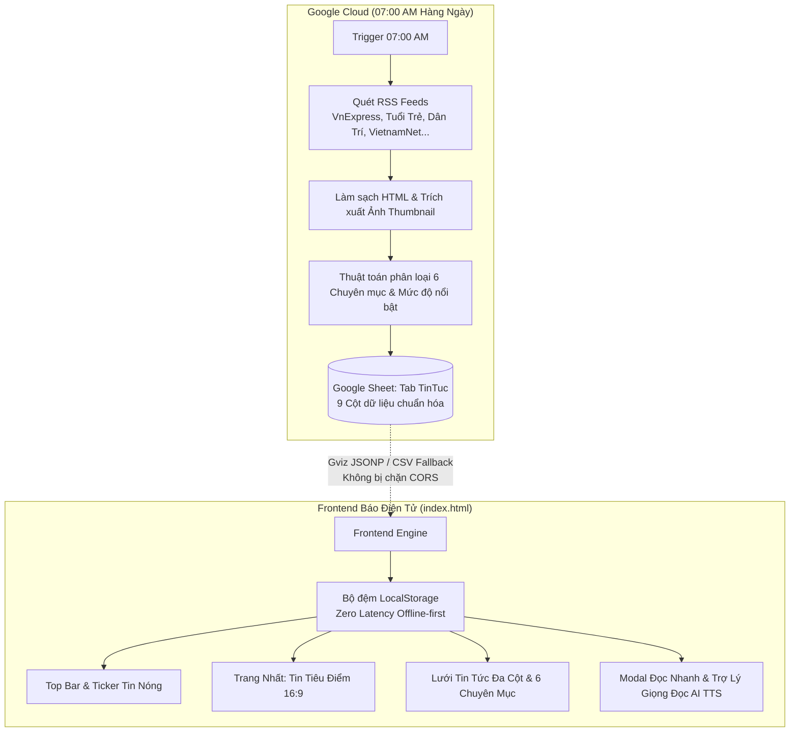

# HỆ THỐNG CỔNG TIN TỨC ĐIỆN TỬ TỰ HÀNH (NEWS PORTAL AUTOMATION)
### Đồng bộ Google Sheet & Google Apps Script Pipeline • Cập nhật 07:00 Sáng Hàng Ngày

---

## 📌 1. TỔNG QUAN HỆ THỐNG

Hệ thống **Cổng Tin Tức Điện Tử Tự Hành (Autonomous News Portal)** là giải pháp tổng hợp và phân phối tin tức chuyên sâu hoàn toàn tự động 100%, không cần máy chủ riêng (Serverless), chi phí vận hành 0 VNĐ.

Hệ thống bao gồm 2 cấu phần chính được kết nối chặt chẽ:
1. **Backend / Data Pipeline (`Code.gs`):** Chạy trên Google Apps Script (Google Cloud), tự động quét các luồng RSS báo chí chính thống uy tín (VnExpress, Tuổi Trẻ, Dân Trí, VietnamNet, Thanh Niên, TechCrunch, Arxiv...), phân loại thông minh vào 6 chuyên mục trọng tâm, tóm tắt nhanh (TL;DR 2-3 câu), trích xuất ảnh đại diện và lưu vào Google Sheet làm cơ sở dữ liệu.
2. **Frontend News Portal (`index.html`):** Ứng dụng đơn file (Single Page Application - SPA) chuẩn mực tòa soạn báo chí quốc tế. Sử dụng cơ chế kết nối **Google Visualization API (GViz JSONP)** và cơ chế dự phòng **CSV Fallback** giúp đồng bộ dữ liệu thời gian thực **100% không bị chặn CORS**.

---

## 🗂️ 2. QUY CHUẨN 6 CHUYÊN MỤC TRỌNG TÂM

| Chuyên Mục | Biểu Tượng | Bộ Từ Khóa Trọng Tâm Nhận Diện |
| :--- | :---: | :--- |
| **Thiên tai** | 🚨 | Bão, áp thấp nhiệt đới, lũ quét, sạt lở đất, triều cường, động đất, hạn hán, sụt lún, vỡ đê, xả lũ hồ chứa, ngập lụt, mưa lũ, sóng thần... |
| **Thời tiết cực đoan** | ⛈️ | Nắng nóng kỷ lục, rét đậm, rét hại, mưa đá, lốc xoáy, gió giật mạnh, sương muối, nghịch nhiệt, tia UV nguy hại, băng giá... |
| **Tai nạn** | ⚠️ | Tai nạn giao thông đường bộ/sắt/thủy/hàng không, cháy nổ, hỏa hoạn, cứu hộ cứu nạn, sập công trình, đuối nước, chìm tàu... |
| **Chính trị** | 🏛️ | Nghị quyết, chính sách ban hành, kỳ họp Quốc hội, đối ngoại ngoại giao, chỉ đạo điều hành Chính phủ, cải cách thể chế, dự thảo luật... |
| **Công nghệ AI** | 🤖 | Trí tuệ nhân tạo, LLM, mô hình ngôn ngữ lớn, OpenAI, Google DeepMind, chip bán dẫn AI, robot tự hành, quy định quản lý AI... |
| **Thủ thuật IT** | 💻 | An toàn thông tin, bảo mật mạng, mẹo phần mềm, thủ thuật Windows/Linux/Mac, tối ưu hóa hệ thống, lập trình, phím tắt công nghệ... |

---

## 📊 3. CẤU TRÚC 9 CỘT DỮ LIỆU TRÊN GOOGLE SHEET

Khi chạy `Code.gs`, hệ thống sẽ tự động tạo Header và định dạng chuẩn 9 cột tại Tab `TinTuc`:

| Cột | Tên Cột | Kiểu Dữ Liệu | Ví Dụ |
| :---: | :--- | :--- | :--- |
| **A** | `STT` | Số nguyên | `1`, `2`, `3`... |
| **B** | `Thời gian xuất bản` | Chuỗi `dd/MM/yyyy HH:mm` | `21/10/2026 06:45` |
| **C** | `Chuyên mục` | 1 trong 6 chuyên mục | `Công nghệ AI` |
| **D** | `Tiêu đề bài báo` | Chuỗi văn bản | `Google DeepMind công bố thế hệ mô hình mới...` |
| **E** | `Tóm tắt nhanh (TL;DR)` | Chuỗi 2-3 câu | `Google DeepMind vừa chính thức giới thiệu đột phá...` |
| **F** | `Nguồn báo chí` | Tên tòa soạn | `VnExpress`, `Tuổi Trẻ`, `Dân Trí`... |
| **G** | `Link bài viết gốc` | Đường dẫn URL | `https://vnexpress.net/...` |
| **H** | `Ảnh thumbnail` | URL hình ảnh | `https://images.unsplash.com/...` |
| **I** | `Mức độ nổi bật` | Phân loại tin | `Tin tiêu điểm`, `Tin nóng`, `Tin thường` |

---

## 🚀 4. HƯỚNG DẪN CÀI ĐẶT BACKEND GOOGLE APPS SCRIPT (CODE.GS)

### Bước 1: Tạo mới Google Sheet
1. Mở trình duyệt và truy cập: [https://sheets.new](https://sheets.new) để tạo một bảng tính mới.
2. Đổi tên bảng tính thành: `Database - Cổng Tin Tức Điện Tử 24H`.

### Bước 2: Thiết lập Chia sẻ (Quan trọng để Frontend đọc được)
1. Bấm nút **Chia sẻ (Share)** ở góc trên bên phải màn hình.
2. Tại mục *Quyền truy cập chung (General access)*, đổi từ "Hạn chế" sang:
   👉 **"Bất kỳ ai có đường liên kết" (Anyone with the link)** với vai trò **"Người xem" (Viewer)**.
3. Bấm **Sao chép đường liên kết** (URL này sẽ dán vào `index.html`).

### Bước 3: Dán mã nguồn Apps Script
1. Trên thanh menu của Google Sheet, chọn: **Tiện ích mở rộng (Extensions)** ➔ **Apps Script**.
2. Xóa toàn bộ mã mặc định trong tệp `Mã.gs` (hoặc `Code.gs`).
3. Mở tệp `D:\Anti\news-portal\Code.gs` (hoặc `D:\Anti\Code.gs`), sao chép toàn bộ nội dung và dán vào trình soạn thảo.
4. Bấm biểu tượng **Lưu (Save - Ctrl+S)**.

### Bước 4: Chạy thử nghiệm lần đầu
1. Tại thanh công cụ của Apps Script, ở ô chọn hàm, chọn hàm: `chayThuNghiemNgay`.
2. Bấm nút **Chạy (Run)**.
3. Google sẽ yêu cầu cấp quyền: Bấm **Xem lại quyền** ➔ Chọn tài khoản của bạn ➔ Bấm **Nâng cao (Advanced)** ➔ Bấm **Đi tới Dự án (Không an toàn)** ➔ Bấm **Cho phép (Allow)**.
4. Sau 5-10 giây, kiểm tra lại trang tính Google Sheet của bạn: Tab `TinTuc` sẽ xuất hiện với đầy đủ màu sắc, tiêu đề và hàng chục tin tức mới nhất được bóc tách và phân loại.

### Bước 5: Cài đặt Trigger tự động chạy 07:00 sáng
Bạn có thể cài đặt theo 1 trong 2 cách cực kỳ đơn giản:
- **Cách 1 (Tự động 1 click):** Trong Apps Script, chọn hàm `thietLapTriggerHangNgay` rồi bấm nút **Chạy (Run)**. Hệ thống sẽ tự động tạo lịch chạy hàng ngày từ 07:00 AM - 08:00 AM (Múi giờ Hà Nội).
- **Cách 2 (Thủ công):** 
  - Chọn biểu tượng **Đồng hồ (Triggers)** ở menu bên trái Apps Script.
  - Bấm nút **+ Thêm trình kích hoạt (Add Trigger)** ở góc dưới bên phải.
  - Chọn hàm thực thi: `tuDongTongHopTinTucHangNgay`.
  - Chọn nguồn sự kiện: **Theo thời gian (Time-driven)**.
  - Loại trình kích hoạt: **Bộ đếm thời gian theo ngày (Day timer)**.
  - Khung giờ: **7 giờ sáng đến 8 giờ sáng (7am to 8am)**.
  - Bấm **Lưu (Save)**.

---

## 💻 5. HƯỚNG DẪN SỬ DỤNG FRONTEND (INDEX.HTML)

1. Mở tệp `D:\Anti\news-portal\index.html` (hoặc `D:\Anti\index.html`) bằng bất kỳ trình duyệt web nào (Chrome, Edge, Firefox, Cốc Cốc, Safari...).
2. **Trải nghiệm ngay lập tức (Offline-First):** Trang web đã được tích hợp sẵn 18 bài viết mẫu chất lượng cao, đa dạng cho 6 chuyên mục với hình ảnh tỉ lệ vàng 16:9 sắc nét.
3. **Kết nối đến Google Sheet của bạn:**
   - Bấm vào nút có chấm tròn trạng thái trên thanh công cụ góc phải: **`Sheet: Sẵn sàng / Cấu hình`**.
   - Dán URL hoặc ID Google Sheet của bạn vào ô nhập.
   - Bấm **Kiểm Tra & Đồng Bộ Ngay**.
   - Dữ liệu sẽ tự động được tải qua Google Visualization API mà không lo lỗi CORS. Lần sau khi bạn mở trang, hệ thống sẽ tự động nạp từ bộ nhớ đệm `localStorage` trong tích tắc (0ms) và đồng bộ ngầm phiên bản mới nhất từ Sheet.

### Các tính năng nổi bật trên giao diện:
- **⚡ Ticker Tin Nóng (Marquee):** Dải tin tức khẩn cấp chạy liên tục. Bấm vào tiêu đề bất kỳ để mở bài đọc ngay.
- **🎙️ Bộ Đọc Trợ Lý AI (Web Speech API):** Trong cửa sổ đọc nhanh bài báo, bấm nút **Nghe tóm tắt** để nghe giọng đọc tiếng Việt rõ ràng, kèm sóng âm thanh (Equalizer) sống động và tùy chỉnh tốc độ `0.8x`, `1.0x`, `1.2x`.
- **🔍 Tìm kiếm tức thì (Live Search):** Bấm phím tắt `/` để kích hoạt nhanh thanh tìm kiếm. Lọc theo từ khóa trong tiêu đề, tóm tắt và nguồn báo.
- **⭐ Lưu đọc sau (Bookmarks):** Bấm vào biểu tượng bookmark để lưu bài viết vào mục "Đã lưu" trên thiết bị.
- **🌓 Giao diện Tối/Sáng (Dark/Light Mode):** Chuyển đổi mượt mà và tự động ghi nhớ sở thích của người dùng.
- **📱 Responsive hoàn hảo:** Tối ưu hóa từ màn hình điện thoại di động 360px cho tới màn hình máy tính để bàn 4K.

---

## 🛠️ 6. XỬ LÝ SỰ CỐ & CÂU HỎI THƯỜNG GẶP (FAQ)

**Q1: Trang web báo "Không thể kết nối đến Google Sheet" thì xử lý thế nào?**
> **Trả lời:** Hãy đảm bảo bạn đã mở Google Sheet, bấm nút **Chia sẻ (Share)** và đổi quyền truy cập thành: **"Bất kỳ ai có đường liên kết đều có thể xem" (Anyone with the link can view)**. Nếu để ở chế độ "Hạn chế", Google sẽ chặn không cho phép bên ngoài truy vấn dữ liệu.

**Q2: Tại sao một số nguồn RSS không trích xuất được ảnh thumbnail?**
> **Trả lời:** Một số bài viết RSS không đính kèm thẻ `<enclosure>` hoặc thẻ `` trong tóm tắt. Đừng lo lắng! Mã nguồn `Code.gs` và `index.html` đã được tích hợp bộ ảnh dự phòng chất lượng cao (Unsplash CDN) theo từng chuyên mục tương ứng, đảm bảo mọi bài viết luôn hiển thị hình ảnh hoàn hảo.

**Q3: Tôi muốn thêm các nguồn báo hoặc từ khóa mới thì sửa ở đâu?**
> **Trả lời:** Trong tệp `Code.gs`, bạn chỉ cần thêm nguồn RSS vào mảng `RSS_FEEDS` hoặc bổ sung từ khóa nhận diện vào mảng `CATEGORY_RULES` ở phần đầu tệp.
